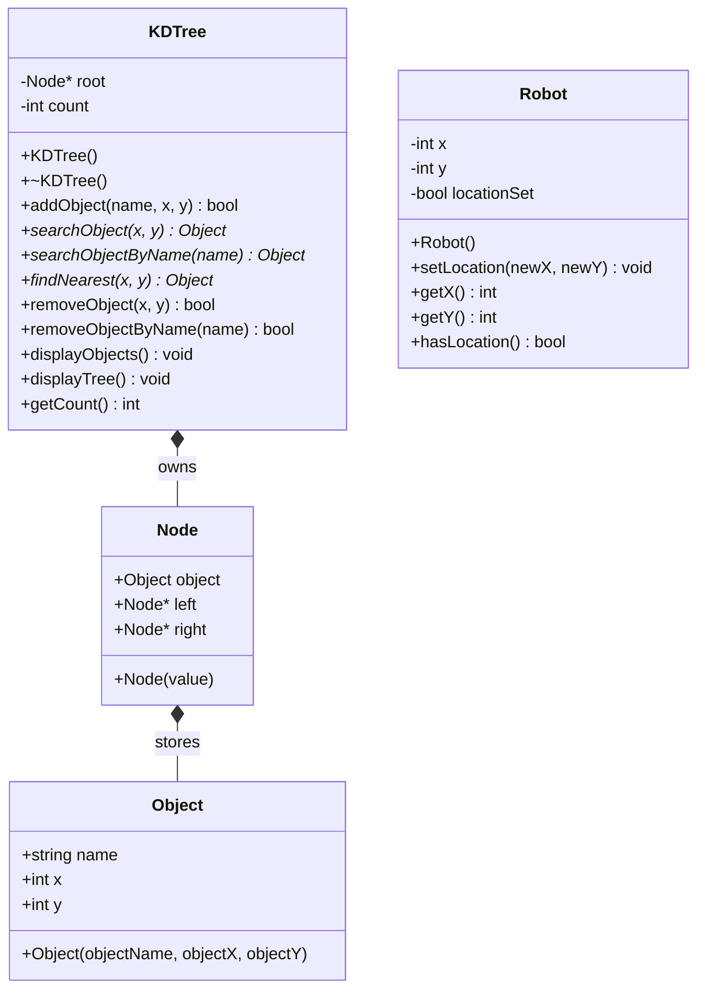

# Current C++ design notes

The source code in `Source-Code/` is the authoritative version included in this repository. This note describes the current design because the earlier PowerPoint UML and PDF research report refer to an older version of the program.

## `KDTree` class

**Private attributes:**
- `root: Node*`
- `count: int`

**Public functions:**
- `KDTree()` constructor
- `~KDTree()` destructor
- `addObject(name, x, y): bool`
- `searchObject(x, y): const Object*` — coordinate search
- `searchObjectByName(name): const Object*` — name search (added later)
- `findNearest(x, y): const Object*`
- `removeObject(x, y): bool` — coordinate removal by rebuild
- `removeObjectByName(name): bool` — name removal (added later)
- `displayObjects(): void`
- `displayTree(): void`
- `getCount(): int`

**Private helper functions:** `insertNode`, `searchNode`, `searchName` (added later), `nearestNode`, `collectObjects`, `printTree`, `clear`.

Other types: `Object` holds an object name plus X and Y; `Node` holds an `Object` and left/right child pointers.

## `Robot` class

Defined in `Source-Code/main.cpp`.
- Attributes: `x: int`, `y: int`, `locationSet: bool`
- Functions: `Robot()`, `setLocation(newX, newY)`, `getX()`, `getY()`, `hasLocation()`

## Relationships

- `KDTree` owns the `Node` tree. Each `Node` stores an `Object` and has child pointers.
- The main program creates one `KDTree` and one `Robot`.
- The robot's position is stored separately from object coordinates.
- Name lookup visits nodes because the tree is organized by X and Y, not by the names.
- Removal rebuilds the KD-Tree from the remaining objects, so its root and traversal order can change.

## Diagram (GitHub renders Mermaid)

The Mermaid chart is an **additional, current** design reference, not a replacement for the provided UML PowerPoints.
